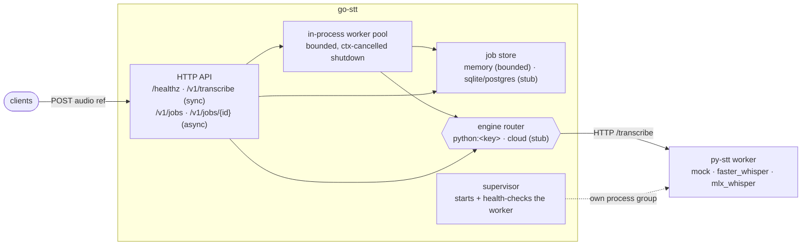

# go-stt

The Go half of **stt-service**: an HTTP speech-to-text service with a sync path for dictation, an async job queue for batch work, a bounded job store, and a supervisor that boots the Python model worker so the whole local stack starts with one command. Models live in the sibling repo [py-stt](https://github.com/selivanov-tech/py-stt); this service never imports Python.

[](https://github.com/selivanov-tech/go-stt/actions/workflows/ci.yml)

Module `github.com/selivanov-tech/go-stt` · Go 1.26 · standard library only (no third-party deps).

## Status

**Step 1 done: the scaffold runs end to end with the mock engine.** HTTP API, in-process worker pool, in-memory job store, worker supervision, config validation, graceful shutdown, tests and CI are in place. Real local models work through the Python worker (faster-whisper, MLX Whisper). What is still a stub is listed under Roadmap; the code says so too (`CloudEngine` and the sqlite/postgres store return "not implemented").



Design and locked decisions: [SPEC.md](SPEC.md).

## Run

Local, mock engine, no models:

```bash
( cd ../py-stt && uv sync )     # one-time: the worker's env
make dev                        # go service :8080, autostarts the worker :8090

curl localhost:8080/healthz
curl -X POST localhost:8080/v1/transcribe \
  -H 'content-type: application/json' \
  -d '{"audio_path":"clip.wav","language":"en"}'
```

Real model on Apple Silicon:

```bash
( cd ../py-stt && uv sync --extra mlx && make worker )   # terminal 1
STT_DEFAULT_ENGINE=python:mlx_whisper make server        # terminal 2
```

Async path:

```bash
curl -X POST localhost:8080/v1/jobs -H 'content-type: application/json' \
  -d '{"audio_url":"https://example.com/clip.wav","engine":"python:faster_whisper"}'
# → 202 {"job_id":"…","status":"queued"}
curl localhost:8080/v1/jobs/<job_id>
# → {"job_id":"…","status":"done","engine":"faster_whisper","text":"…","latency_ms":1234}
```

## API

| Method | Path | Purpose |
|---|---|---|
| `GET` | `/healthz` | status, profile, default engine, worker URL |
| `POST` | `/v1/transcribe` | sync transcribe; blocks until the engine answers (5 min cap) |
| `POST` | `/v1/jobs` | enqueue; returns `202 {job_id, status:"queued"}`; `503` when the queue is shut down |
| `GET` | `/v1/jobs/{id}` | job state: `queued · running · done · failed`, text, error, latency |

Request body (both transcribe routes), one audio field required:

```json
{ "audio_path": "…", "audio_url": "…", "audio_base64": "…", "language": "en", "engine": "python:mlx_whisper", "model": "large-v3-turbo" }
```

Requests are capped at 32 MiB. `engine` defaults to `STT_DEFAULT_ENGINE`.

## How it is built

| Package | What it does |
|---|---|
| `internal/api` | `net/http` mux with Go 1.22+ method routing; sync handler, submit handler, poll handler, health. Job IDs are 96-bit random hex. |
| `internal/engine` | `Engine` interface (`Name`, `Transcribe(ctx, AudioRef, Options) (Result, error)`). `Build(spec)` routes `python:<key>` and `mock` to the HTTP worker client, anything else to `CloudEngine` (stub). Swapping HTTP for gRPC later is a new `Engine`, not a caller change. |
| `internal/queue` | `Queue` interface + `InProc`: a bounded worker pool. The task channel is never closed; shutdown cancels a context, so no `Submit` can pin a lock across a blocking send and the shutdown deadline always wins. `Submit` after shutdown returns `ErrClosed`. |
| `internal/store` | `Store` interface + `Memory`: RW-mutex map bounded to 10,000 jobs with oldest-first eviction. `Build("sqlite"|"postgres")` returns "not implemented" on purpose. |
| `internal/worker` | `Supervisor` starts the Python worker in its own process group, `Stop` sends `SIGTERM` to the group and `SIGKILL` after 5 s; `WaitHealthy` polls `/health` for up to 60 s. |
| `internal/config` | Env-driven config with `Validate()`: the `production` profile refuses to boot on the in-memory store, because it loses jobs on restart and grows without bound. |
| `cmd/server` | Wiring: config → store → optional supervisor → queue → HTTP server; `SIGINT`/`SIGTERM` drain the server (10 s), shut the queue down, stop the worker. `log/slog` text logs. |

## Configuration

| Variable | Default | Purpose |
|---|---|---|
| `STT_ADDR` | `:8080` | listen address |
| `STT_PROFILE` | `local` | `local` or `production`; production requires a durable store |
| `STT_STORE` | `memory` | `memory` works; `sqlite` / `postgres` are not implemented yet |
| `STT_DEFAULT_ENGINE` | `python:mock` | `python:<mock|faster_whisper|mlx_whisper>` or a cloud provider name (stub) |
| `STT_QUEUE_WORKERS` | `2` | worker-pool size |
| `STT_QUEUE_BUFFER` | `256` | queued jobs before `Submit` blocks |
| `STT_WORKER_URL` | `http://127.0.0.1:8090` | py-stt worker base URL |
| `STT_WORKER_AUTOSTART` | `false` | start the worker from this process (`make dev` sets it) |
| `STT_WORKER_CMD` / `STT_WORKER_DIR` | — | command and working dir for the supervised worker |
| `DEEPGRAM_API_KEY` … | — | reserved for the cloud engines (not wired yet) |

See [`.env.example`](.env.example).

## Test and lint

```bash
make test     # go test ./...   (CI runs it with -race)
make lint     # golangci-lint v2: default set + bodyclose, misspell, unconvert; gofmt + goimports
```

Tests cover the API handlers (health, sync transcribe, missing-audio validation, the async job lifecycle, unknown job → 404) with a fake engine, config validation, the store (backend selection and oldest-first eviction), and the queue (every submitted task runs). CI: [`ci.yml`](.github/workflows/ci.yml) runs lint and race tests on every push and pull request.

## Roadmap

From [SPEC.md](SPEC.md), in order:

1. Run the eval in py-stt on real EN/RU recordings and pick the default model.
2. A real cloud engine in Go (Deepgram or AssemblyAI) for the `production` profile, plus API-key auth.
3. Durable job store (SQLite, then Postgres) so `production` can boot.
4. macOS voice-input app as the first client of `/v1/transcribe`.
5. asynq/Redis queue for multi-node; gRPC + streaming for real-time voice.

## Project

Part of **stt-service**, split into two repos cloned side by side:

| Repo | Role |
|---|---|
| **go-stt** (this) | Go service: HTTP API, queue, workers, job store, supervision |
| [py-stt](https://github.com/selivanov-tech/py-stt) | Python: STT engines, FastAPI model worker, eval harness |
