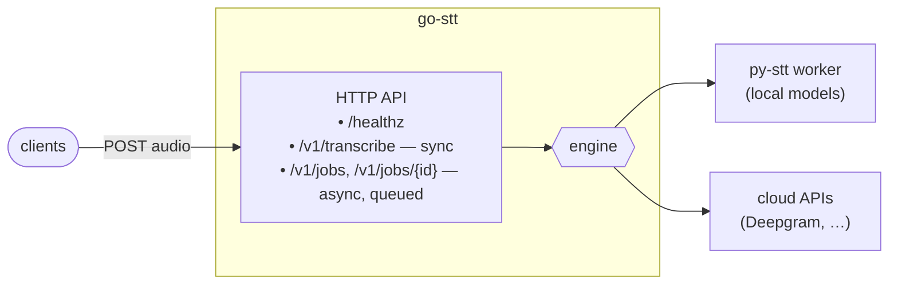

# go-stt

> **Status: early draft (WIP).** Code lands incrementally — this README is the plan.

Go service for the **stt-service** project: HTTP API, job queue, worker pool, job
store, and worker supervision. It calls the Python model worker
([py-stt](https://github.com/selivanov-tech/py-stt)) for local transcription, and
cloud STT APIs directly in the production profile.

Module: `github.com/selivanov-tech/go-stt`.



Design + decisions: [SPEC.md](SPEC.md).

## Run (local, mock engine — no models)

```bash
( cd ../py-stt && uv sync )    # one-time: set up the worker env
make dev                        # go service :8080, autostarts the worker :8090

curl localhost:8080/healthz
curl -X POST localhost:8080/v1/transcribe \
  -H 'content-type: application/json' -d '{"audio_path":"clip.wav","language":"en"}'
```

## Run with a real model (Apple Silicon)

```bash
( cd ../py-stt && uv sync --extra mlx && make worker )   # terminal 1
STT_DEFAULT_ENGINE=python:mlx_whisper make server        # terminal 2
```

## API

| Method | Path | Purpose |
|---|---|---|
| GET | `/healthz` | health |
| POST | `/v1/transcribe` | sync transcribe (fast path) |
| POST | `/v1/jobs` | async — returns `{job_id}` |
| GET | `/v1/jobs/{id}` | poll a job's result |

Body: `{ "audio_path"|"audio_url"|"audio_base64", "language"?, "engine"?, "model"? }`.

## Test

```bash
make test     # go test ./...
make lint     # golangci-lint run (install: brew install golangci-lint)
```

## Project

Part of **stt-service**, split into two repos — clone them side by side:

| Repo | Role |
|---|---|
| **go-stt** (this) | Go service: HTTP API, queue, workers, job store, supervision |
| [py-stt](https://github.com/selivanov-tech/py-stt) | Python: STT engines, FastAPI model worker, eval harness |
